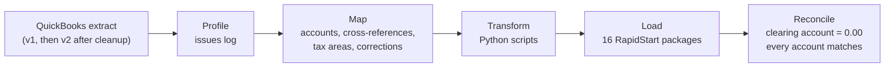

# QuickBooks Online to Business Central Migration

**Video walkthrough (9 min):** https://youtu.be/4nT_AlCPxe8

A complete data migration from **QuickBooks Online** to **Microsoft Dynamics 365 Business Central** for a fictional Charlotte distributor, **rehearsed in two trial runs and reconciled to the cent**: in the final run, all 54 accounts with a balance match QuickBooks exactly and the opening balance clearing account ends at **$0.00**.

> **Portfolio project.** The client (Queen City Supply Co.), its people and all data are fictional; the QuickBooks exports are generated by a script. Trial run 1 ran in a local Business Central 28.3 container, trial run 2 in a Business Central online sandbox (BC 29.0) in a trial tenant. Sales tax rates were verified against the NC and SC departments of revenue at the dates noted in the decision log.

## What was migrated

| Area | Volume | Loaded through | Reconciled to |
|---|---|---|---|
| Chart of accounts | 60 QuickBooks accounts → 364 BC accounts (176 unused template accounts blocked) | RapidStart | Account mapping |
| Customers / vendors / items | 40 / 22 / 61 (one duplicate customer merged, one inactive customer excluded) | RapidStart, cross-reference files | QuickBooks lists |
| Open receivables | 37 invoices and credit memos, $169,777.55 | Customer ledger (journal) | A/R Aging Detail |
| Open payables | 27 bills and vendor credits, $81,160.02 | Vendor ledger (journal) | A/P Aging Detail |
| Inventory | 59 items, $164,831.46 at FIFO | Item journal | Inventory Valuation |
| Bank and credit card | 4 accounts, $139,720.18, opening reconciliation | Bank account ledger | Trial balance |
| Other balances and year-to-date P&L | 47 accounts | G/L journal | Trial balance |
| Setup | Posting groups, NC/SC sales tax (6 counties, dated rates), payment terms, units of measure, 1099 forms | RapidStart, manual steps | Day-one tests |

## Approach

- **Profile before mapping.** Every finding went into the issues log and was decided by the client, never silently fixed: a duplicate customer, missing addresses that decide sales tax, a missing SKU, a miscoded income account, undeposited funds, a bill entered twice, negative stock.
- **Two kinds of correction.** Master-data fixes (a ZIP code, a merged customer) are applied by the transformation from a documented corrections file. Financial fixes (a duplicate bill, a count adjustment) are posted in QuickBooks by the accountant and arrive in a new extract, which is compared line by line with the previous one.
- **Opening balances through subledgers.** Open invoices, bills, stock and bank balances are loaded one document per line through their own ledgers, so aging, collections, FIFO costing and bank reconciliation work from day one. Only the remaining balances go through the G/L.
- **One clearing account proves the load.** All five loads post against 25900 Opening Balance Clearing; when everything is in, it must be exactly zero.
- **Scripts refuse to build bad files.** Each transformation stops if a record is missing from a cross-reference, a total differs from the trial balance, or a check fails.

## Two trial runs

| | Trial run 1 | Trial run 2 |
|---|---|---|
| Environment | Docker container, BC 28.3 | BC online sandbox, BC 29.0 |
| Accounts matching QuickBooks | 53 of 55 | **54 of 54** |
| 25900 Opening Balance Clearing | -0.09 | **0.00** |
| Manual corrections | None (I-018 left unpatched by design, fixed in the method) | None |

What trial run 1 found, and how trial run 2 proved the fixes:

- **Opening stock was $0.09 too high** (I-018). BC recalculates an item journal's cost from the unit amount rounded to 0.001, so the amount entered is not the amount posted. The cause was proven by simulating BC's rounding, which predicted the posted total exactly. The stock script now simulates BC's posting and splits items so the posted value is exact; trial run 2 posted $164,831.46 to the cent.
- **System timestamps in a package** made 16 records look modified instead of 1 (I-001); removed from the packages, proven in trial run 2.

What trial run 2 found on the newer version:

- **BC 29.0 no longer created item units of measure** when the base unit was set through RapidStart (I-021), which would have blocked every sales and purchase document. Fixed with two packages that load the units explicitly and work on both versions.
- **A blocked template account was still referenced by Tax Setup** (I-022), invisible to both the blocking script and BC's Where-Used List. Fixed, and a manual review of single-record setup pages added to the runbook.

## Key design decisions

| Decision | Why |
|---|---|
| Hybrid chart of accounts: BC structure, client account names, unused accounts blocked (D-003, D-022) | QuickBooks Online has no account numbers; posting setup keeps working |
| A MIGRATION posting group for opening stock (D-006) | Opening stock credits the clearing account, not cost of goods sold |
| Posting date 9/30/2026, original document and due dates (D-017) | The G/L matches QuickBooks at the cutover; aging and collections are correct |
| Year-to-date income and expenses loaded per account (D-005) | Business Central produces the full-year 2026 P&L on its own |
| Sales tax by state and county with dated rates (D-011) | Mecklenburg County's rate changed on 7/1/2026; BC applies the rate by document date |
| 1099: Jan–Sep amounts as IRS adjustments, 1099 fields on opening contractor bills (I-011, I-017) | A mid-year cutover splits the year's payments between two systems; proven by BC's own 1099 calculation |

All 23 decisions and 22 issues: [docs/decision-log.md](docs/decision-log.md), [docs/issues-log.md](docs/issues-log.md).

## Repository map

| Folder | Contents |
|---|---|
| [docs/](docs/) | Client brief, decision and issues logs, [runbook](docs/runbook.md), [cutover checklist](docs/cutover-checklist.md), reconciliation reports for [trial run 1](docs/reconciliation-trial-run-1.md) and [trial run 2](docs/reconciliation-trial-run-2.md), [comparison with BC's built-in QuickBooks migration](docs/built-in-tools-comparison.md) |
| [source/qbo-exports/](source/qbo-exports/) | Generated QuickBooks exports: master data, cutover extract v1, and [extract-v2](source/qbo-exports/extract-v2/) after the accountant's corrections |
| [mapping/](mapping/) | Account mapping, customer/vendor/item cross-references, corrections, city-to-tax-area rules, payment terms, reconciliation targets |
| [tools/](tools/) | Source data generator, extract comparison, package builders and transformations, block candidates, trial balance reconciliation |
| [packages/](packages/) | RapidStart import files, [review change lists](packages/reviews/), and exported [package definitions](packages/rapidstart/) |
| [reconciliation/](reconciliation/) | BC exports and account-by-account reconciliation for both trial runs |

## How to reproduce

Requires Python 3 with `openpyxl`, and a Business Central company created from **Production – Setup data only** (US).

1. `python tools/generate_source_data.py` recreates the QuickBooks exports (extract v1 and v2).
2. `python tools/compare_extracts.py source/qbo-exports source/qbo-exports/extract-v2` shows the differences between the extracts and checks each one's control accounts.
3. Follow [docs/runbook.md](docs/runbook.md): for each package, import the definition from `packages/rapidstart/`, export its Excel template, build the import file with the matching script in `tools/`, then import, check the predicted counts, and apply.
4. Export the chart of accounts and run `python tools/reconcile_trial_balance.py <export.xlsx> <run name>`.

## Video walkthrough

Coming soon.

## Author

**Issaka Mohammed** · Certified Dynamics 365 Business Central Developer (MB-820) and Functional Consultant (MB-800) · [LinkedIn](https://www.linkedin.com/in/issakamo)

Other Business Central projects: [Warehouse Control](https://github.com/issakamo/business-central-warehouse-control) · [Purchase Control](https://github.com/issakamo/business-central-purchase-control) · [FX Integration](https://github.com/issakamo/business-central-fx-integration) · [Finance Analytics](https://github.com/issakamo/business-central-finance-analytics)
